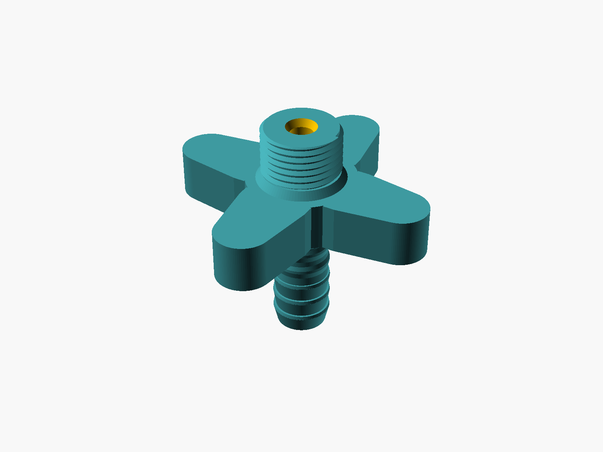
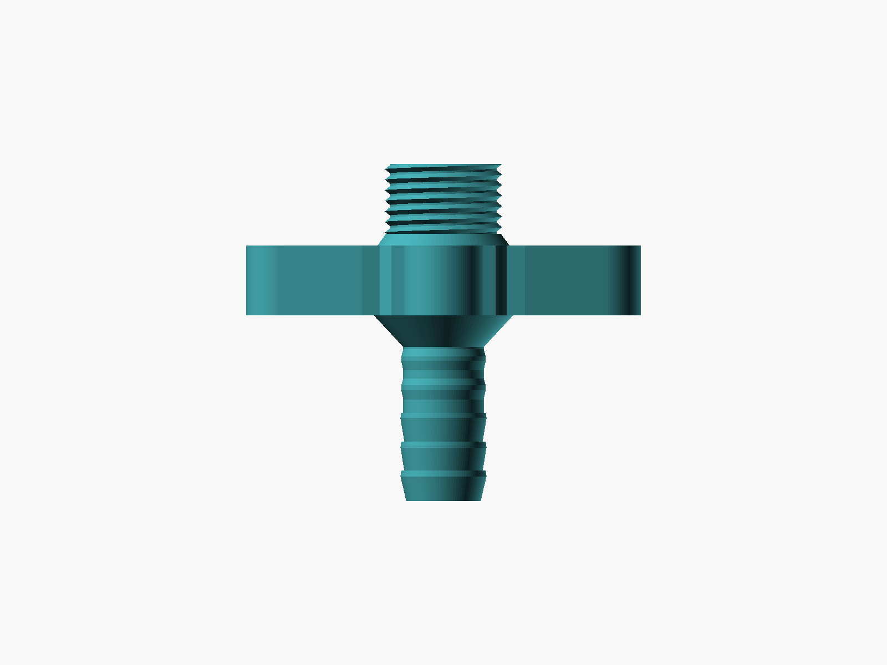
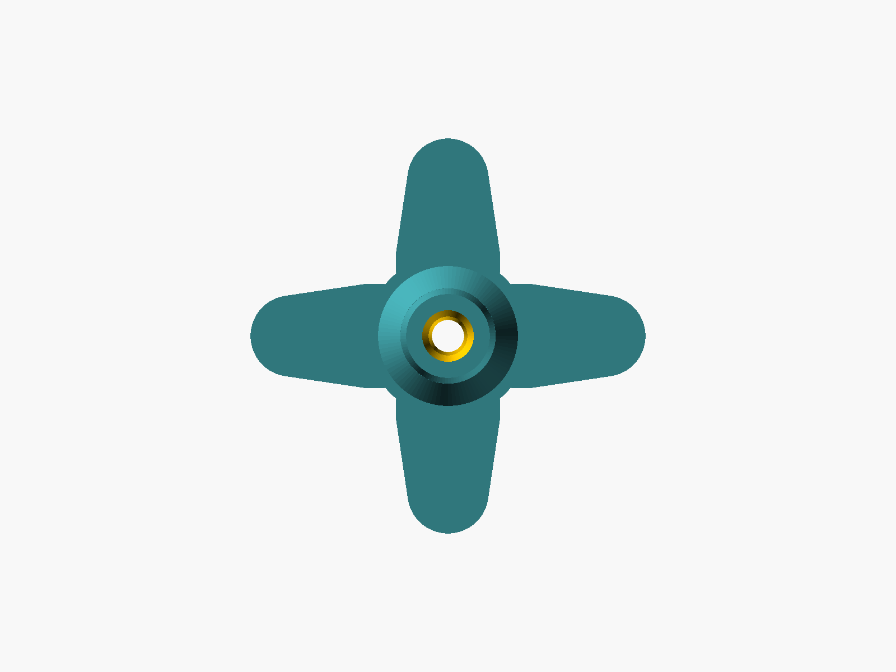

# G 1/2" to Hose Barb Adapter

[](LICENSE)

A heavy-duty, 3D-printable adapter that connects a standard G 1/2" shower hose to a flexible aquarium or garden hose. It screws into the shower hose nut by hand using a cross handle (a faucet-style knob), and the hose is pushed onto a barb and held there with a worm-drive hose clamp.

The model is written in OpenSCAD and is fully parametric. Each version is a single self-contained `.scad` file. Ready-to-print STLs for the default dimensions are next to them.

## 📷 Gallery

<p align="center">
  
  
  
</p>

* **3D view:** the v2 adapter rendered in OpenSCAD, with the G 1/2" thread on top, the cross knob in the middle and the hose barb below.
* **Side view:** the stress-relief collar at the root of the thread, the anti-snap cone under the knob, the two clamp ribs and the three barb teeth.
* **View along the axis:** the 4-spoke cross knob and the 6 mm internal bore.

### Printed prototype (v1)

<p align="center">
  
  
  
</p>

* **Top view:** the printed adapter standing upright, showing the internal bore and the cross handle.
* **Side profile:** the central hub, the hose barb teeth and the G 1/2" thread.
* **Assembled system:** the adapter screwed into a metal shower hose fitting, with a flexible hose secured by a worm-drive clamp.

The photos show the printed v1. v2 looks almost the same. The visible differences are small: a slightly larger and thicker knob, a short conical collar at the base of the thread, a cone under the knob, and two ribs in the clamp zone.

## 🧩 Versions

| Version | File | Description |
|---------|------|-------------|
| **v2 – Heavy-Duty Reinforced** (recommended) | `shower-to-hose-adapter-3d-printerv2.scad` | Thicker walls (6 mm bore), anti-snap cones at the thread root and under the knob, larger barb teeth with flat crests, and retention ribs in the clamp zone. The thread fit is corrected, so you print it at 100%. |
| **v1 – Original** | `shower-to-hose-adapter-3d-printer.scad` | The first printed version: G 1/2" thread, cross knob, 3-tooth barb and a smooth clamp shank. The thread only fits after scaling it to 98% in the slicer (see Fit & Tolerances below). |

Each `.scad` file has a matching `.stl` with the same name.

## 📏 Default Dimensions

With the default parameters, the two versions have the following specifications:

| | **v2** | **v1** |
|---|---|---|
| **Shower thread** | G 1/2" (BSPP), 14 mm (12 mm thread + 2 mm stress-relief collar) | G 1/2" (BSPP), 12 mm |
| **Thread diameter (printed)** | ~20.17 mm crest / ~18.37 mm root | ~20.59 mm crest (fits only at 98%) |
| **Thread pitch** | 1.814 mm (14 TPI, nominal) | 1.796 mm (scaled by 0.99) |
| **Hose barb** | for a 12.5 mm (1/2") ID hose, 3 teeth, ~13.4 → 14.9 mm, flat crests | for a 12.5 mm (1/2") ID hose, 3 teeth, ~12.6 → 14.1 mm |
| **Clamp shank** | 17 mm, ~13.8 mm, 2 retention ribs (~14.5 mm) | 15 mm, ~13.1 mm, smooth |
| **Internal bore** | 6.0 mm, conical lead-ins at both ends | 7.5 mm |
| **Cross knob** | 4 spokes, Ø28 mm hub, 12 mm thick, ~68 mm across | 4 spokes, Ø26 mm hub, 10 mm thick, ~66 mm across |
| **Overall height** | 58 mm | 52 mm |

## ✨ Features

* **One File per Version:** each `.scad` file contains all of its parameters and geometry, so you can open, customise and export it on its own (it also works with the OpenSCAD Customizer).
* **Fully Parametric:** adjust the hose diameter, thread clearance, scaling factors and wall thickness to fit your setup.
* **Tool-Free Tightening:** the large 4-spoke cross knob gives enough leverage to tighten the adapter by hand. The rounded spoke tips are comfortable to grip with wet hands.
* **Heavy-Duty Walls (v2):** the narrow 6 mm bore leaves about 3.7–6.4 mm of solid wall everywhere, so the part doesn't crack or crush under a metal worm-drive clamp.
* **Anti-Snap Reinforcements (v2):** a conical collar at the root of the thread and a cone between the clamp shank and the knob replace the sharp 90° corners where the part was most likely to break.
* **Worm-Drive Clamp Zone (v2):** a thicker shank with two raised ribs keeps the hose from slipping off under pressure once the clamp is tightened.
* **Durable Barb Teeth (v2):** larger teeth with a flat crest, so the tips don't print thin and brittle or shear off.
* **Flat Thread Ends:** the thread is trimmed flat at both ends, so the shower hose gasket seals against a clean face.

## 🚀 Usage

1. Install [OpenSCAD](https://openscad.org/).
2. Open `shower-to-hose-adapter-3d-printerv2.scad` (recommended) or the v1 file.
3. Set `hose_inner_diam` to the inner diameter of your flexible hose. If needed, adjust the other values in the table below.
4. Render the model (**F6**) and export an STL (**F7**).
   Ready-made STLs for the default dimensions are in the repository root.
5. Print v2 at **100%**. Print v1 at **98%** (thread fit, see below).

### Key parameters

| Parameter | Default (v2) | Description |
|-----------|--------------|-------------|
| `hose_inner_diam` | `12.5` | Inner diameter of the flexible hose (mm). All barb and shank sizes follow from it. |
| `thread_clearance` | `0.15` | Extra reduction of the thread diameter (mm) |
| `thread_scale` | `0.97` | Scale factor for the thread diameter (v1: `0.99`) |
| `thread_depth` | `0.98` | Radial depth of the thread. Keep the root below the nut's minor diameter (18.63 mm). |
| `thread_length` | `14` | Length of the threaded section, including the collar |
| `barb_scale` | `1.01` | Scale factor for the barb and shank (a tighter fit in the hose) |
| `barb_teeth_count` / `barb_tooth_height` | `3` / `5` | Number and height of the barb teeth |
| `smooth_shank_len` | `17` | Length of the clamp zone |
| `handle_hub_diam` / `handle_height` | `28` / `12` | Knob hub diameter and thickness |
| `handle_spoke_len` | `20` | Length of the knob spokes |
| `bore_diam` | `hose_inner_diam - 6.5` | Internal bore (6.0 mm by default) |

## 📁 Project Structure

```
shower-to-hose-adapter-3d-printer/
├── shower-to-hose-adapter-3d-printerv2.scad   # v2 – Heavy-Duty Reinforced (recommended)
├── shower-to-hose-adapter-3d-printerv2.stl    # Ready-to-print STL for v2 (print at 100%)
├── shower-to-hose-adapter-3d-printer.scad     # v1 – Original
├── shower-to-hose-adapter-3d-printer.stl      # Ready-to-print STL for v1 (print at 98%)
├── images/                                    # OpenSCAD renders of v2
├── LICENSE                                    # CC BY-NC-SA 4.0
└── README.md
```

## 🖨️ Recommended Print Settings

The adapter has to be watertight and hold mains water pressure without the layers splitting apart:
* **Material:** PETG or PETG-CF (carbon fiber), for good layer adhesion and impact resistance. Don't use TPU (too soft for the thread) or standard PLA (too brittle).
* **Layer height:** 0.12–0.16 mm. Low layers are needed to print the fine pitch of the G 1/2" thread accurately.
* **Walls:** 3–4 perimeters for watertightness and strength.
* **Top/bottom thickness:** 1.2–1.6 mm.
* **Z-seam:** 'Aligned' or 'Sharpest Corner'. Don't use 'Random', because seam bumps scattered over the thread stop the shower gasket from sealing properly.

## ⚠️ Fit & Tolerances

FDM plastics shrink slightly as they cool. The scripts compensate for this:
* **Thread (v2):** the diameter is scaled down by 3% (`thread_scale = 0.97`, ~20.17 mm crest / ~18.37 mm root) for a smooth fit in the shower hose nut. This value is tested: v1 with `0.99` only fitted after an extra 98% scale in the slicer (0.99 × 0.98 ≈ 0.97), so v2 has that correction built in. **Print v2 at 100%, no slicer scaling needed.**
* **Thread (v1):** scale the model to **98%** in the slicer, or the thread will be too tight for the nut.
* **Pitch:** in v2 the pitch stays at the nominal 1.814 mm (14 TPI) and is not scaled, so the thread stays in step with the nut over its whole length.
* **Hose barb:** scaled up by 1% (`barb_scale = 1.01`) for a tight, watertight seal against the flexible hose.
* **If the thread binds:** lower `thread_scale` a little (e.g. `0.96`). If it is loose, raise it. Only the thread diameter changes.

> **Assembly tip:** before pushing the hose onto the barb, dip its end in boiling water for about 30 seconds. The heat softens the rubber/PVC, so it slides over the scaled-up teeth easily. As it cools, it shrinks tightly around the printed part. Secure it with a metal worm-drive clamp on the clamp zone for a permanent, leak-proof connection.

## 📝 Changelog

**v2.1** – Thread fit fixed for printing at 100%
* `thread_scale` 0.99 → 0.97 (crest ~20.17 mm, the same as the 98%-scaled v1 print that fitted)
* Explicit `thread_depth = 0.98` → printed root ~18.37 mm (v2's shallower root was larger than the nut's minor diameter)
* Pitch kept at the nominal 1.814 mm (no longer scaled)
* v1 restored as its own file next to v2

**v2** – Heavy-Duty Reinforced
* Bore reduced from 7.5 mm to 6.0 mm for thicker walls throughout, plus conical lead-ins at both ends
* Thread length increased from 12 to 14 mm, with a 2 mm conical stress-relief collar at its base
* Cross knob: hub 26 → 28 mm, height 10 → 12 mm, spoke base 16 → 18 mm, spokes merged deeper into the hub
* Hose barb: larger teeth (root +0.8 mm, crest +2.2 mm over the hose ID) with flat crests
* Clamp shank lengthened (15 → 17 mm) and thickened, with two retention ribs for a worm-drive clamp
* Anti-snap cone added between the shank and the knob

**v1** – Initial release: G 1/2" thread, cross knob, 3-tooth barb, smooth clamp shank.

---
*This project is source-available under the [Creative Commons Attribution-NonCommercial-ShareAlike 4.0 International](LICENSE) license (CC BY-NC-SA 4.0). You are free to share and adapt it for non-commercial purposes, as long as you give credit and release your changes under the same license. If you wish to use this project for commercial purposes, please contact me. Developed and designed by Maciej Ślubowski.*
